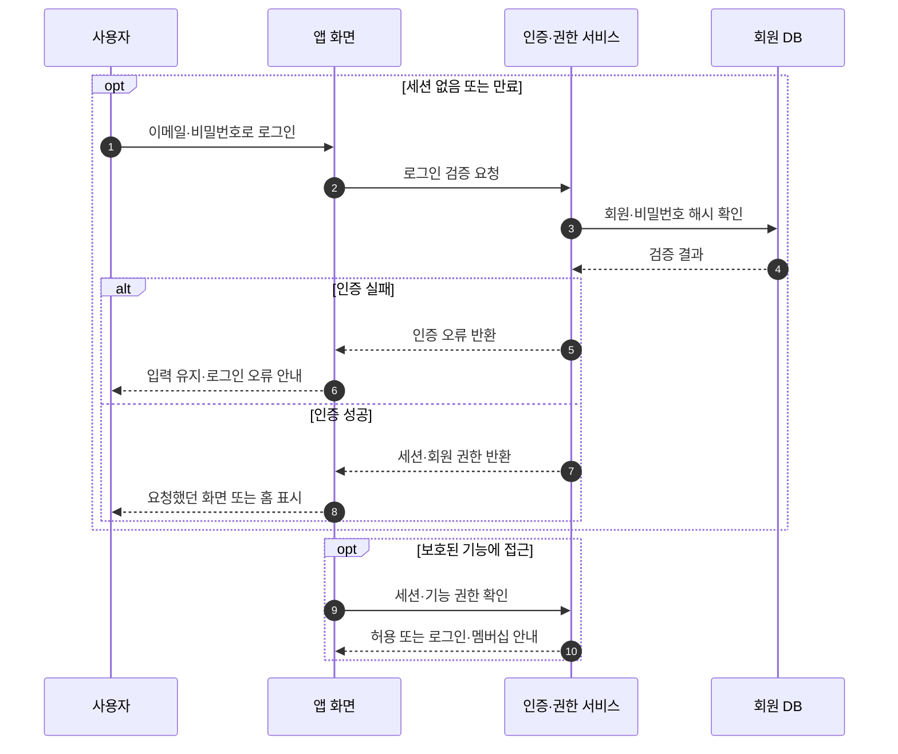
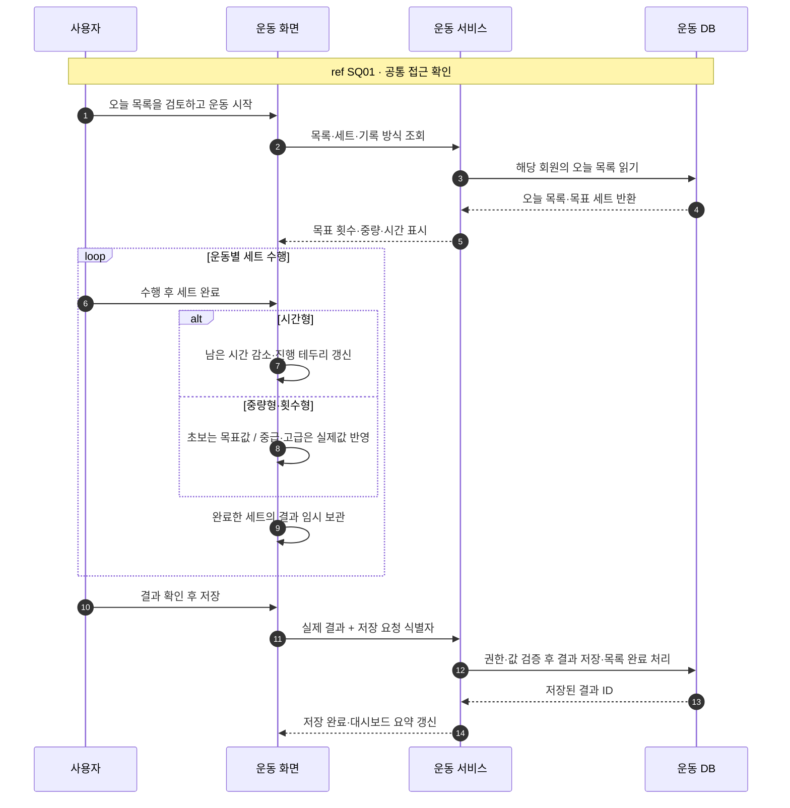
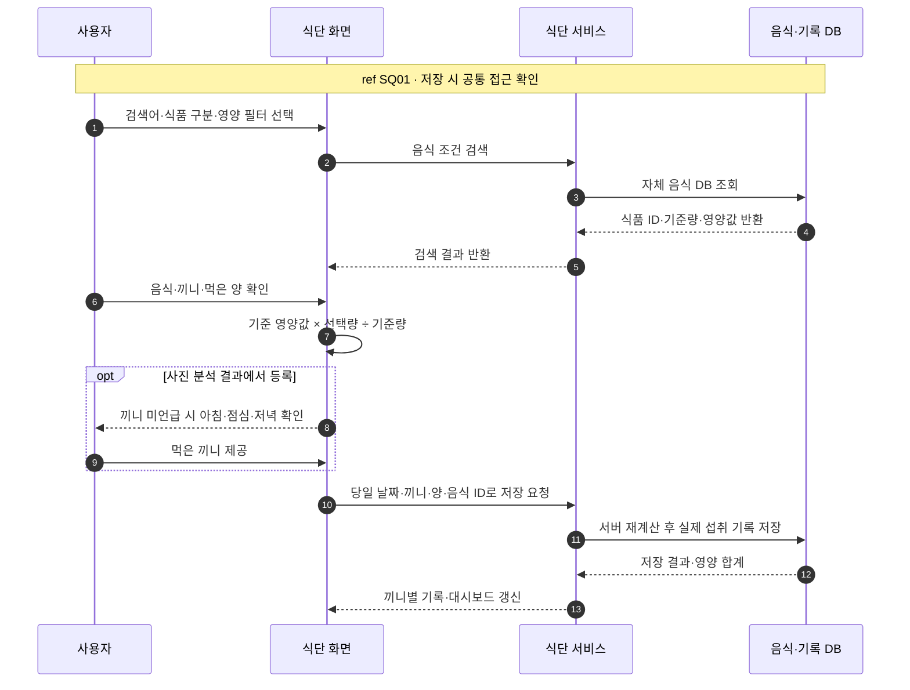
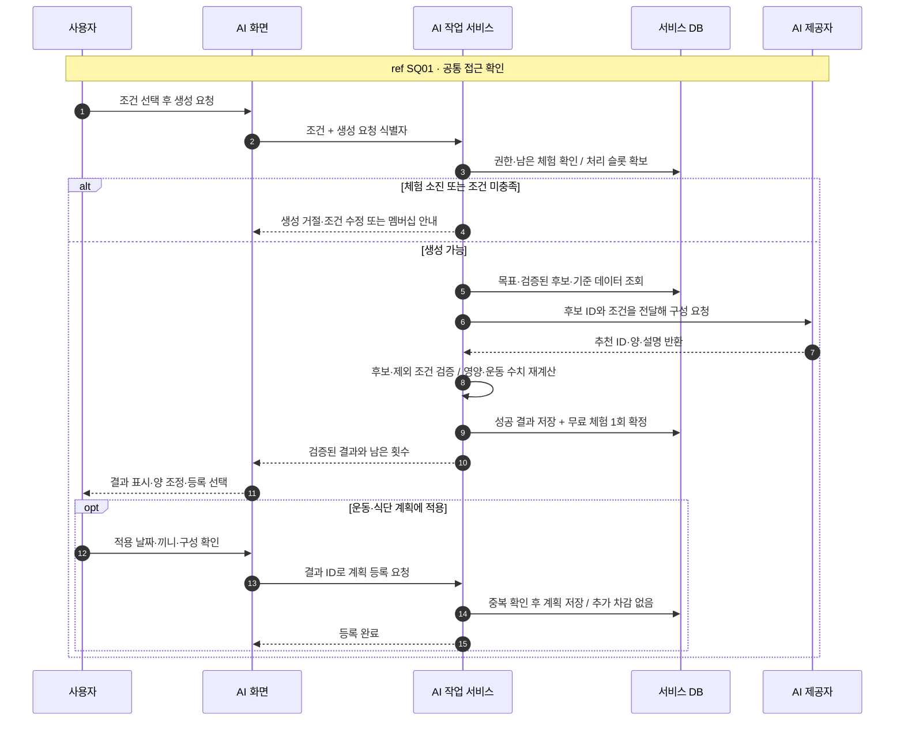
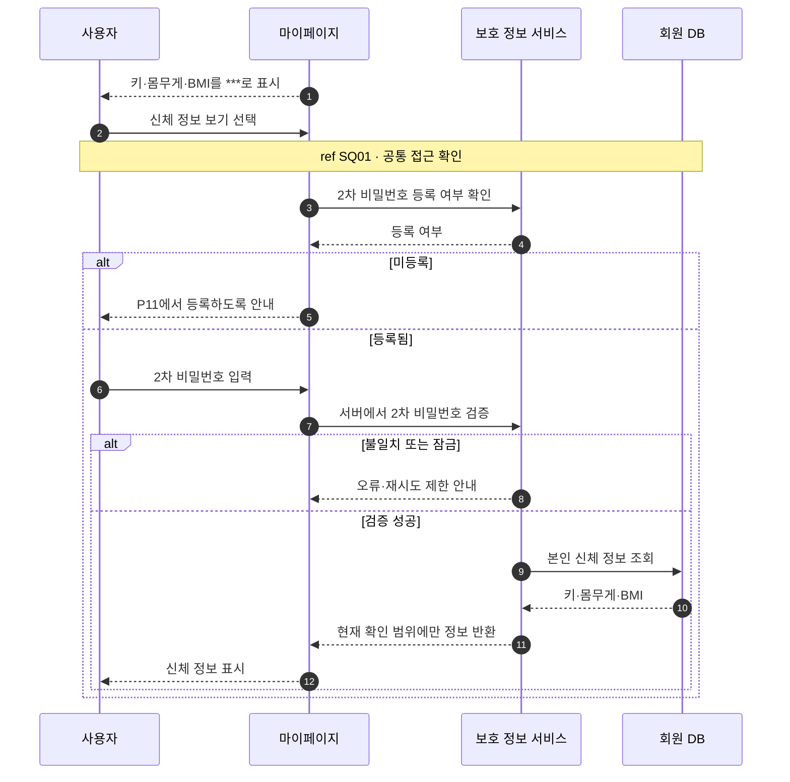
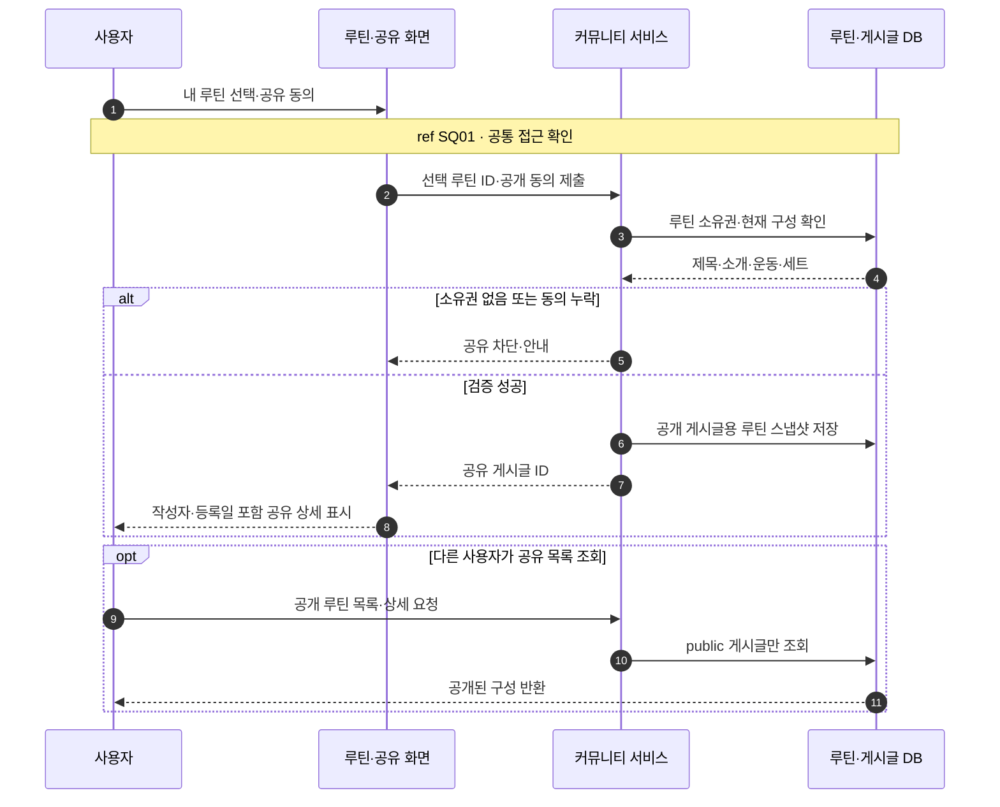
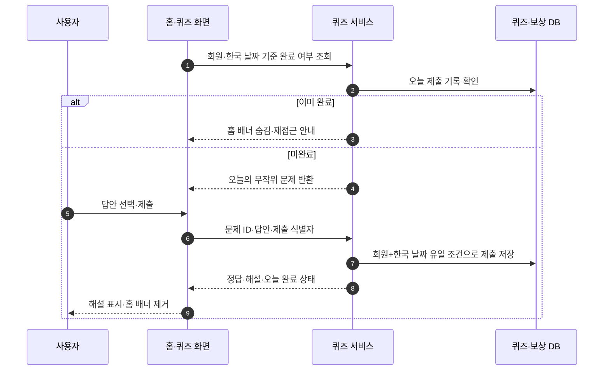
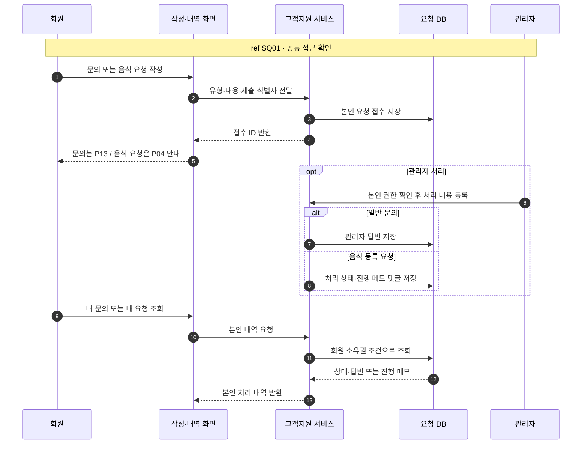

# 밀스루틴 실무형 시퀀스 설계

핵심 6개·보조 2개. 구현 완료 문서가 아닌 현재 UX 기반 서버 연동 설계안.

## SQ01 로그인과 공통 접근 확인

화면: A01, H01, P03

세션을 가진 사용자가 허용된 기능에 접근한다. 로그인 자체에 2차 비밀번호를 요구하지 않는다.

예외: 세션 만료는 로그인, AI 신규 생성 체험 소진은 멤버십 안내. 이미 생성된 마지막 결과 조회·등록은 허용한다.

## SQ02 운동 목록 수행과 결과 저장

화면: W01, W02, W10, W11, W14-1, W14-2, W14-3, W15, W15-1

운동을 완료한 실제 값이 기록에 저장되고 대시보드가 운동 후 상태로 바뀐다.

예외: 내일 목록은 구성·검토만 허용. 일시정지는 운동 시간에서 제외. 미완료 세트는 실제 완료로 저장하지 않으며 중복 저장 요청은 같은 결과를 반환한다.

## SQ03 음식 검색과 끼니 기록 저장

화면: F01, F02, D02, D01, D01-1, D01-2, D01-3, I04-1

당일의 선택한 끼니에 실제 섭취 기록을 저장한다. 사진 분석 등록은 추정값으로 구분한다.

예외: 검색 결과 없음은 조건 수정·음식 등록 요청으로 안내. 영양 미확인과 0 구분, g/ml 임의 변환 금지. AI 식단 추천은 실제 기록이 아닌 내일 계획에 저장한다.

## SQ04 AI 생성·체험 차감·계획 적용

화면: I02-1, I03, I03-1, I03-2, I03-3, I05-2, P03, W10, D02-1

공통 AI 생성 정책으로 권한·작업 중복·완료 시 차감을 통제한다. 기록과 계획 적용은 분리한다.

예외: 실패·취소·유효하지 않은 AI 응답은 차감하지 않는다. 확보한 처리 슬롯은 실패 시 해제하며 횟수 차감으로 간주하지 않는다. 다섯 번째 성공 결과도 조회·등록 가능. 동시 요청은 서버 원자 처리 필요.

## SQ05 신체 정보 잠금 해제

화면: P01, P05, P06, P09, P11, P12

민감한 신체 정보 확인 시점에만 2차 비밀번호를 사용한다.

예외: 비밀번호 원문·PIN을 응답이나 로그에 남기지 않는다. 숨김 복귀·허용 시간·서버 세션 정책은 운영 구현 시 확정. 현재는 브라우저 시안이다.

## SQ06 개인 운동 루틴의 공개 공유

화면: W06, W07, W08, C02-2, C01-1, C03

개인 루틴의 기본 비공개 상태와 공개 게시글을 구분한다.

예외: 공유되지 않은 개인 루틴은 공개 조회 금지. 공개 스냅샷에 신체 정보·인증 정보 포함 금지. 편집 시 원본과 게시글의 동기화 정책은 미확정이다.

## SQ07 하루 한 번 퀴즈 제출

화면: H01, H02

정오답과 관계없이 하루 한 번 제출을 완료한다.

예외: 동시·중복 제출 방지. 다음 한국 날짜 재참여. 포인트·경험치 지급 정책은 확정되지 않았으므로 이 다이어그램에 지급 처리를 넣지 않는다.

## SQ08 문의·음식 요청과 처리 내역 확인

화면: S02, P13, F03, P04, P04-1, P08

문의 작성 S02와 상태 조회 P13을 분리한다. 음식 등록 요청과 일반 문의는 별개 목록이다.

예외: 관리자 인증·쓰기 UI는 현재 스토리보드 범위 밖의 연동 설계. 포인트 지급 감사 문구는 시안 예시이며 실제 지급 트랜잭션은 별도 정책 확정 후 설계한다.

## 음식 데이터와 추천의 경계

공공 영양 API는 별도 수집 작업으로 자체 음식 DB를 갱신합니다. 사용자 추천마다 전체 외부 API를 호출하는 구조를 가정하지 않습니다. 중복 코드·출처·기준일·g/ml·누락값 처리는 공통 음식 DB 계층에서 관리합니다. AI는 후보 ID·양·설명을 제안하며 영양값을 생성하지 않습니다. UI에서 보여주는 임시 영양 계산은 저장 전 서버에서 재검증합니다.

AI 운동 결과는 오늘·내일 목록 존재 여부에 따른 기존 날짜 결정 규칙을 적용하고, 기존 내일 목록도 있을 때의 덮어쓰기 정책은 확인이 필요합니다. 식단 추천은 내일 계획으로 저장하며 기존 계획 유지·추가 확인을 거칩니다. 주간 코칭은 결과 확인으로 종료하며 운동·식단 계획 적용을 강제하지 않습니다.

## 후속 상세 설계

서비스 URI, DB 테이블, 토큰 방식, 큐·재시도 구현은 확정하지 않았습니다. 관리자 화면, 실제 외부 본인인증·메일·결제, 보상 지급은 별도 설계 범위입니다. 요구사항 확정 시 업무별 상세도를 추가하고 본문에 모든 기술 세부를 합치지 않습니다.

## 참고

- https://www.ibm.com/docs/en/dma?topic=diagrams-interaction-uses-in-sequence
- https://www.visual-paradigm.com/guide/sysml/modeling-scenarios-with-sequence-diagram/1000
